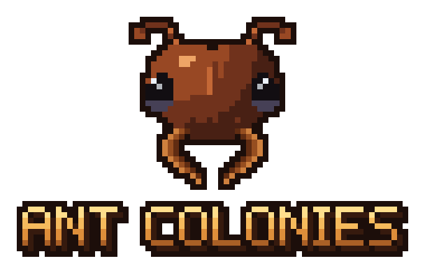
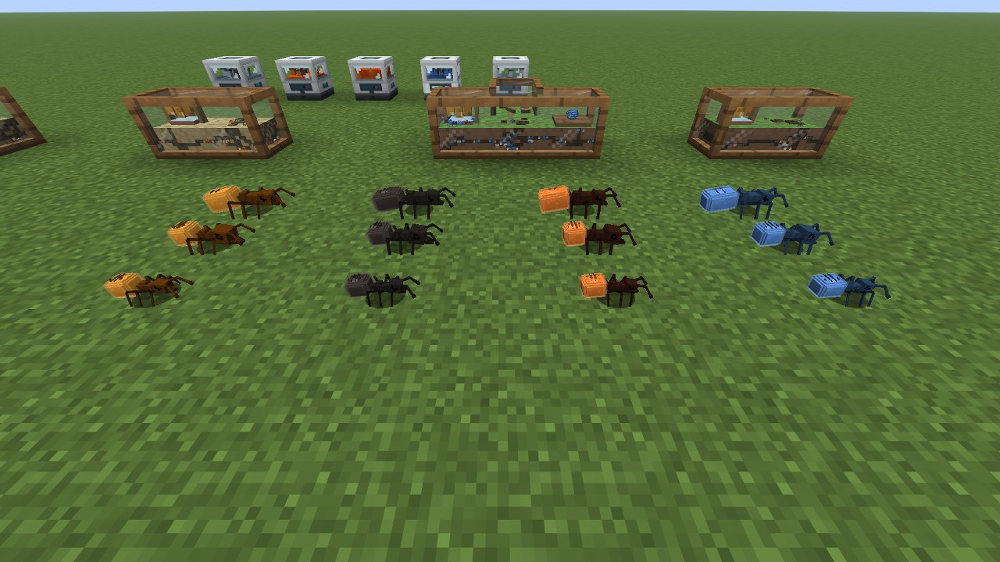

<div align="center">



**Build a civilization, one ant at a time.**

A NeoForge mod for Minecraft 26.3 and 26.1.2: catch wild ants, raise Queens in living Formicariums, and grow colonies
that mine, farm, hunt and evolve.

[](https://www.curseforge.com/minecraft/mc-mods/ant-colonies)
[](https://www.minecraft.net)
[](https://neoforged.net)
[](LICENSE)
[](https://github.com/Kamikadzegga/AntColonies/actions/workflows/build.yml)

[Download](https://www.curseforge.com/minecraft/mc-mods/ant-colonies) · [Features](#features) ·
[Screenshots](#screenshots) · [Installation](#installation) · [Documentation](#documentation)

</div>


## Features

- **Living colonies.** A Formicarium holds a Queen, her brood and thousands of workers you can watch digging behind the
  glass. Chambers placed against it join the colony, and a colony built upward becomes one tall nest.
- **48 species.** Catch 16 wild ones, mutate them into iron, diamond, netherite and other mineral ants, breed hybrids,
  and reach the endgame Wither and Dragon Ants.
- **Genetic research.** Scan materials in the Genetic Laboratory. Discoveries are permanent, fill in the Ant
  Identification Book and unlock species mutations.
- **Genetics.** Every Queen has ten traits and can carry any of 31 mutations, and the game says what each one does. The
  Genetic Laboratory has a page for every step: Research, Analysis, Mutation, Editing, Hybrids and Stability.
- **Hybrids.** Copy a Queen's genes into a Genetic Sample and raise her daughters in another species' Queen Chamber.
  Better Queens make a hybrid more likely, and the chamber shows the chance.
- **Liquid Ants.** Ants that carry water, lava and other mods' fluids, and a Droplet Centrifuge that turns their
  droplets into the real fluid.
- **The Nether and the End.** Expeditions through little portals at home, Colony Connectors that share food and items,
  and species that evolve only there.
- **Giant anthills.** Structures in all three dimensions, shaped by their biome, with loot, soldiers and a great Queen.
- **Chitin gear and Guard Ants.** Four tiers of armor and tools: in a full set, wild ants leave you alone. A Guard Ant
  follows you and fights for you.
- **Made for modpacks.** Species, evolutions, mutations, food and loot are data packs, a server config sets every
  number, and items, fluids and FE move through any mod's pipes and cables. JEI, EMI and Jade are supported.

The [gameplay guide](docs/gameplay.md) explains all of it.

## Screenshots

| | |
|:---:|:---:|
|  |  |
| A living Formicarium | The colony screen |
|  |  |
| A colony built upward: one nest behind glass | Liquid Ants and the Droplet Centrifuge |
|  |  |
| Genetic research: scan a material, keep the discovery | Species Mutation: a Stone Ant Queen becomes an Iron Ant |
|  |  |
| A giant anthill | Chitin, Hardened, Infernal and Void armor |

More in the [gallery](docs/gallery.md).

## Installation

1. Install [NeoForge](https://neoforged.net) for your Minecraft version (26.1.2 needs **26.1.2.122** or newer, Java 25).
2. Download the jar for that version from [CurseForge](https://www.curseforge.com/minecraft/mc-mods/ant-colonies) or
   from the releases below, and put it into your `mods` folder. The mod is needed on both the server and the client.

You are reading the **26.1.2** branch.

| Minecraft | Branch | Latest release |
|---|---|---|
| 26.3 | [`main`](https://github.com/Kamikadzegga/AntColonies/tree/main) | [0.5.0](https://github.com/Kamikadzegga/AntColonies/releases/tag/v0.5.0) |
| 26.1.2 | [`26.1.2`](https://github.com/Kamikadzegga/AntColonies/tree/26.1.2) | [0.4.0](https://github.com/Kamikadzegga/AntColonies/releases/tag/v0.4.0-26.1.2) (the same content as 0.5.0) |

Optional companions: [JEI](https://www.curseforge.com/minecraft/mc-mods/jei) or
[EMI](https://modrinth.com/mod/pf-emi) for recipes, and [Jade](https://www.curseforge.com/minecraft/mc-mods/jade) to
see a colony's state by looking at it.

To start, craft **Tweezers** and **Test Tubes**, catch a wild Queen, and put her in a **Formicarium** with some ant food.
The [gameplay guide](docs/gameplay.md#getting-started) takes it from there.

## Documentation

| Guide | For |
|---|---|
| [Gameplay guide](docs/gameplay.md) | Players: colonies, structures, species, genetics, anthills, gear and settings |
| [Modpack and KubeJS guide](docs/modpack-guide.md) | Pack makers: every data file and field, recipes, food, spawns, config, KubeJS and KubeGroovy scripts |
| [Compatibility](docs/compatibility.md) | Recipe viewers, Jade, and other mods' pipes, cables and ores |
| [Changelog](CHANGELOG.md) | What changed in each version |

## Building from source

You need JDK 25. The Gradle wrapper downloads everything else.

```sh
git clone -b 26.1.2 https://github.com/Kamikadzegga/AntColonies.git
cd AntColonies
./gradlew build        # the jar ends up in build/libs/
./gradlew runClient    # starts a development client
```

[CONTRIBUTING.md](CONTRIBUTING.md) explains how the project is laid out.

## License

Ant Colonies is released under the [MIT License](LICENSE). Copyright (c) 2026 Kamikadzegga.

Minecraft is a trademark of Mojang Studios. This project is not affiliated with Mojang Studios or Microsoft.
