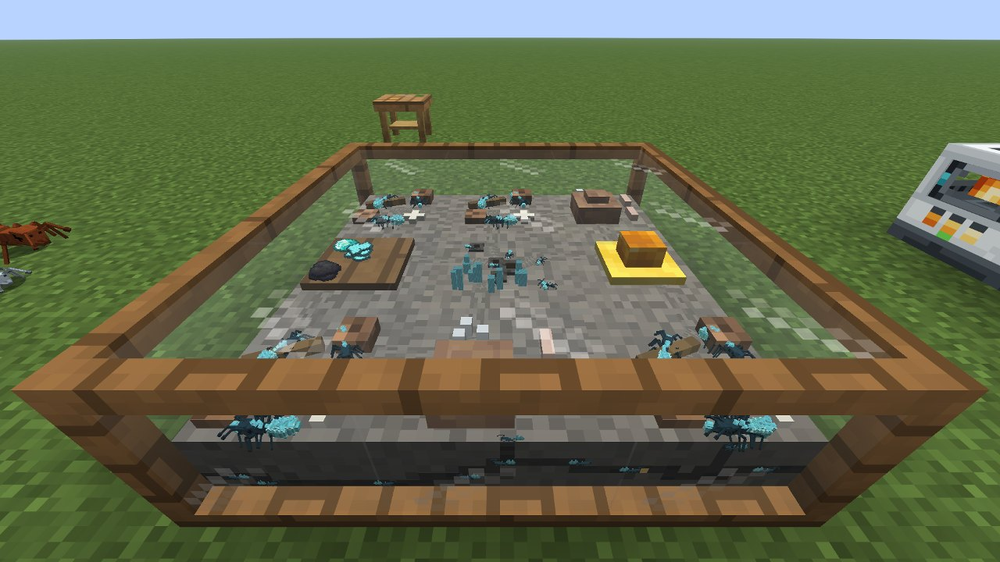
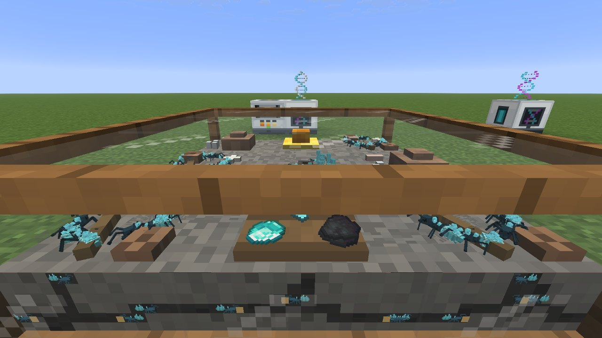
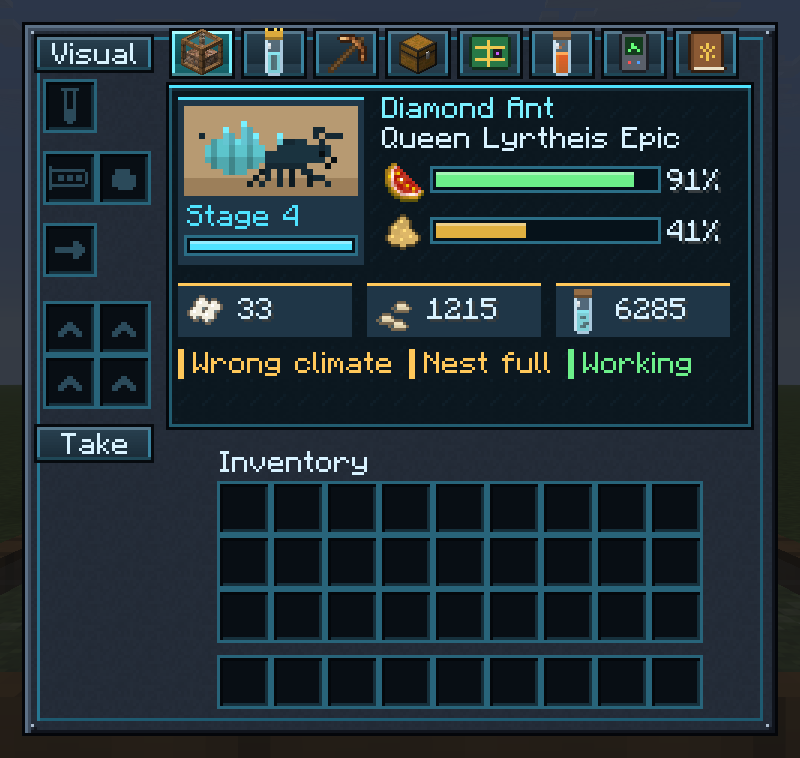
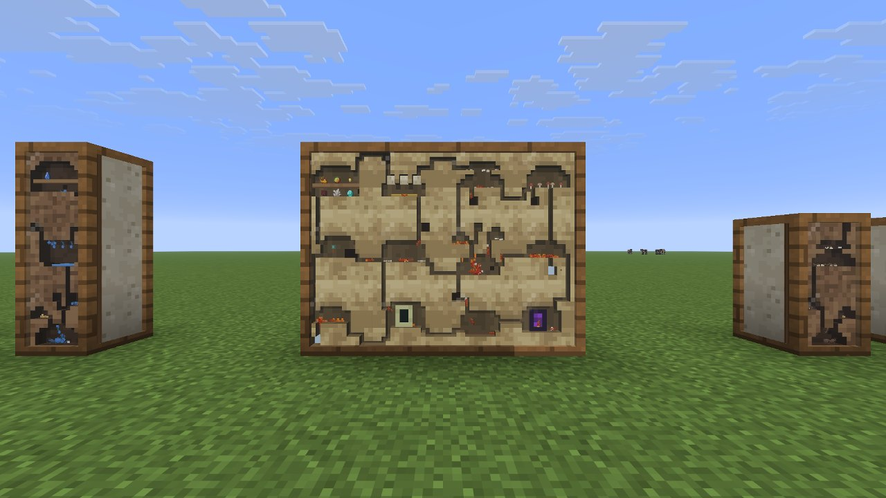
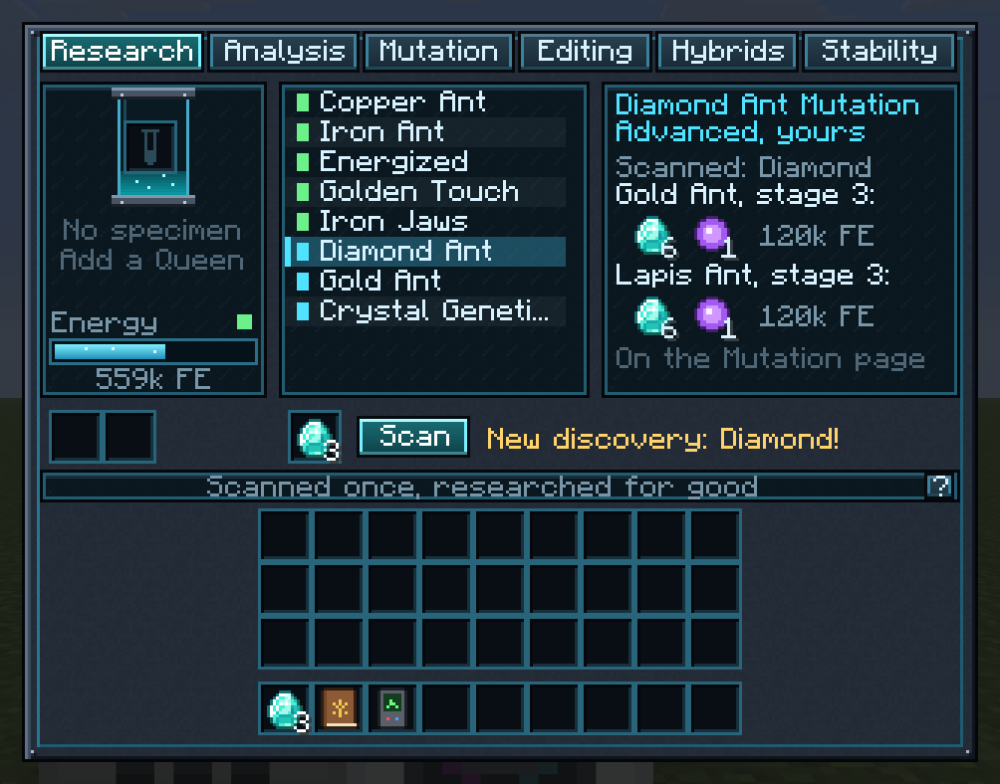
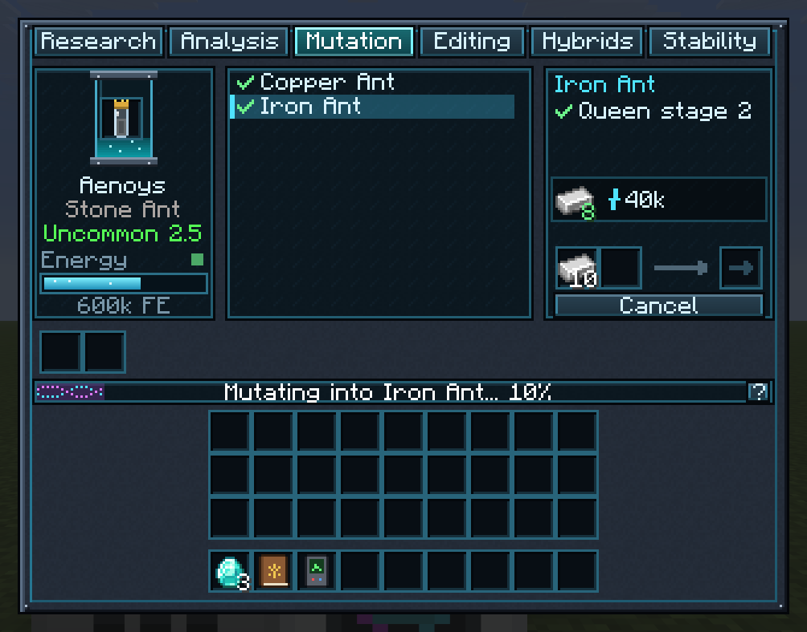
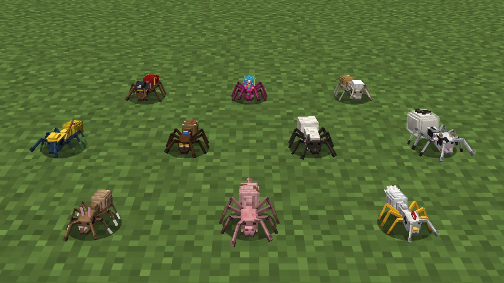
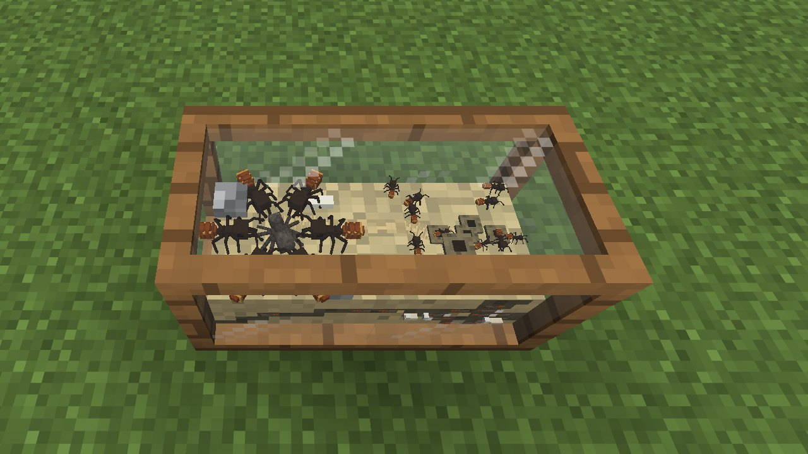
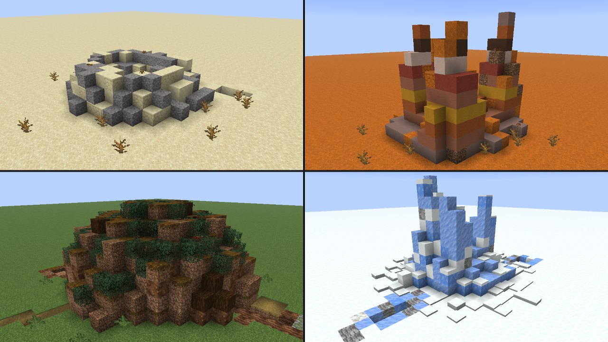
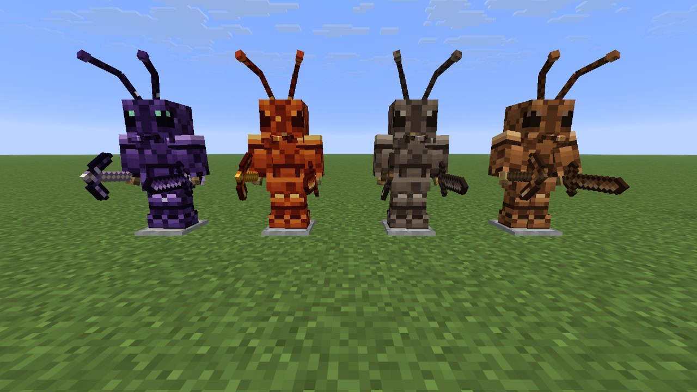

<div align="center">


**Build a civilization, one ant at a time.**

A NeoForge mod for Minecraft 26.3 and 26.1.2: catch wild ants, raise Queens in living Formicariums, and grow colonies
that mine, farm, hunt and evolve.

[](https://www.curseforge.com/minecraft/mc-mods/ant-colonies)
[](https://www.minecraft.net)
[](https://neoforged.net)
[](LICENSE)
[](https://github.com/Kamikadzegga/AntColonies/actions/workflows/build.yml)

[Download](https://www.curseforge.com/minecraft/mc-mods/ant-colonies) · [Features](#features) ·
[Screenshots](#screenshots) · [Installation](#installation) · [Documentation](#documentation)

</div>



## Features

- **Living colonies.** A Formicarium holds a Queen, her brood and thousands of workers you can watch behind the glass.
  Chambers placed against it join the colony.
- **56 species.** Catch 17 wild ones, mutate them into iron, diamond and netherite ants, breed hybrids, and reach the
  endgame Wither and Dragon Ants. Ten are just for fun: a Cow Ant that gives milk, a Baker, a Pirate, a Fisher.
- **Genetic research.** Scan materials in the Genetic Laboratory to discover species mutations and genes for good.
- **Genetics.** Every Queen has ten traits and can carry any of 31 mutations. Edit, cross and stabilize her genes in
  the laboratory.
- **Liquid Ants.** Ants that carry water, lava and other mods' fluids, and a Droplet Centrifuge for their droplets.
- **The Nether and the End.** Expeditions through little portals at home, and Colony Connectors that share food and
  items.
- **Giant anthills.** Structures in all three dimensions, built and furnished to suit their biome, with loot, soldiers
  and a great Queen to catch.
- **Chitin gear and Guard Ants.** Four tiers of armor and tools, and an ant that follows you and fights for you.
- **Made for modpacks.** Species, evolutions, mutations, food and loot are data packs, and a server config sets the
  numbers. JEI, EMI and Jade are supported, and any mod's pipes and cables work.

## Screenshots

| | |
|:---:|:---:|
|  |  |
| A living Formicarium | The colony screen |
|  |  |
| A colony built upward: one nest behind glass | Liquid Ants and the Droplet Centrifuge |
|  |  |
| Genetic research: scan a material, keep the discovery | Species Mutation: a Stone Ant Queen becomes an Iron Ant |
|  |  |
| The ten ants for fun, each in its costume | Hunters fighting at their Hunting Ground |
|  |  |
| Giant anthills in different biomes| Chitin, Hardened, Infernal and Void armor |

More in the [gallery](docs/gallery.md).

## Installation

1. Install [NeoForge](https://neoforged.net) for your Minecraft version (26.3 needs **26.3.0.101** or newer, Java 25).
2. Download the jar for that version from [CurseForge](https://www.curseforge.com/minecraft/mc-mods/ant-colonies) or
   from the releases below, and put it into your `mods` folder. The mod is needed on both the server and the client.

| Minecraft | Branch | Latest release |
|---|---|---|
| 26.3 | [`main`](https://github.com/Kamikadzegga/AntColonies/tree/main) | [0.6.0](https://github.com/Kamikadzegga/AntColonies/releases/tag/v0.6.0) |
| 26.1.2 | [`26.1.2`](https://github.com/Kamikadzegga/AntColonies/tree/26.1.2) | [0.5.0](https://github.com/Kamikadzegga/AntColonies/releases/tag/v0.5.0-26.1.2) (the same content as 0.6.0) |

Optional companions: [JEI](https://www.curseforge.com/minecraft/mc-mods/jei) or
[EMI](https://modrinth.com/mod/pf-emi) for recipes, and [Jade](https://www.curseforge.com/minecraft/mc-mods/jade) to
see a colony's state by looking at it.

To start, craft **Tweezers** and **Test Tubes**, catch a wild Queen, and put her in a **Formicarium** with some ant food.
The [gameplay guide](docs/gameplay.md#getting-started) takes it from there.

## Documentation

| Page | What is in it |
|---|---|
| [Gameplay guide](docs/gameplay.md) | Starting a colony, food, chambers, upgrades, expeditions, Liquid Ants |
| [Species and genetics](docs/species-and-genetics.md) | Every species, research, the Genetic Laboratory, hybrids, traits |
| [World and gear](docs/world-and-gear.md) | Giant anthills, home nests, Chitin gear, Guard Ants, building blocks |
| [Modpack guide](docs/modpack-guide.md) | Data packs: species, recipes, food, spawns, the server config |
| [Scripting](docs/scripting.md) | KubeJS and KubeGroovy examples |
| [Compatibility](docs/compatibility.md) | Recipe viewers, Jade, pipes and cables, ants for other mods' ores and fluids |
| [Gallery](docs/gallery.md) | All the screenshots |
| [Changelog](CHANGELOG.md) | What changed in each version |

## Building from source

You need JDK 25. The Gradle wrapper downloads everything else.

```sh
git clone https://github.com/Kamikadzegga/AntColonies.git
cd AntColonies
./gradlew build        # the jar ends up in build/libs/
./gradlew runClient    # starts a development client
```

[CONTRIBUTING.md](CONTRIBUTING.md) explains how the project is laid out.

## License

Ant Colonies is released under the [MIT License](LICENSE). Copyright (c) 2026 Kamikadzegga.

Minecraft is a trademark of Mojang Studios. This project is not affiliated with Mojang Studios or Microsoft.
