<div align="center">

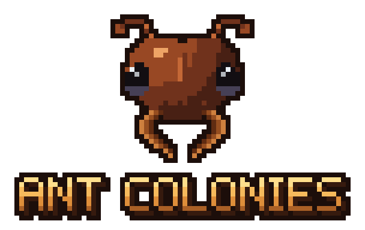

**Build a civilization, one ant at a time.**

A NeoForge mod for Minecraft 26.3: catch wild ants, raise Queens in living Terrariums, put thousands of workers and
hunters to work, evolve mineral species and engineer their genes.

[](https://www.minecraft.net)
[](https://neoforged.net)
[](https://adoptium.net)
[](LICENSE)
[](https://github.com/Kamikadzegga/AntColonies/actions/workflows/build.yml)

[Features](#features) · [Screenshots](#screenshots) · [Installation](#installation) ·
[Documentation](#documentation) · [Building](#building-from-source) · [License](#license)

</div>

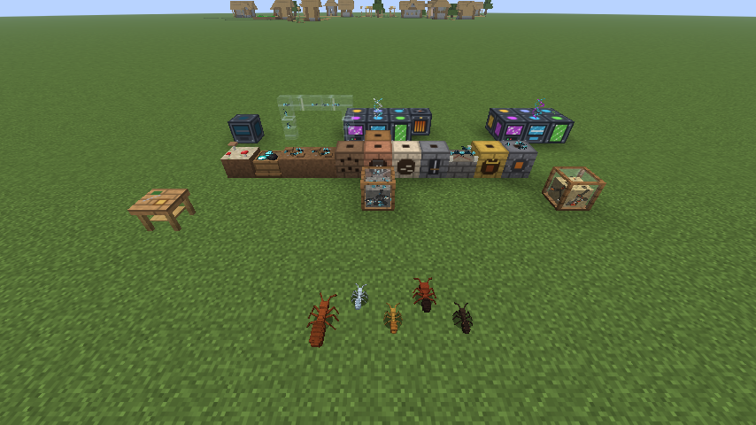

## Features

- **Living colonies.** A Terrarium holds a whole colony: Queen, eggs, larvae, workers, food and health. You
  can watch the ants dig tunnels, carry food and work in the chambers. The simulation is plain numbers on the server,
  so even a colony of thousands costs almost nothing.
- **One build that grows.** A Terrarium works on its own. Chambers placed against it join the colony and merge into one
  glass case: Nest Chambers for a bigger colony, Foraging Sites where workers find resources, Hunting Grounds where
  hunter species kill mobs for their drops and feed on them (no mob is ever spawned), Harvesting Sites for farmers, Storage and Queen Chambers. A block under the Terrarium
  sets its climate.
- **46 species.** Sixteen wild species live in their own biomes, with nests, among them the Army Ant, a hunter, and the
  Nether's Warped Ant and the End's Chorus Ant. Mineral species (iron, gold, diamond, emerald, netherite, ender and more)
  evolve from them, and eleven hybrids come from crossing Queens. The endgame Wither and Dragon Ants need a Nether Star
  and the dragon's breath.
- **Progression through the dimensions.** The Nether's ants evolve only in the Nether and the End's only in the End, and
  the Chitin ladder (Hardened, Infernal, Void) gates tier III upgrades and high genetics behind both. Chitin is never
  crafted: it comes only from ants, wild ones and your colonies. Thirteen more
  species turn on when MachinaOpus, Mekanism, Create, Thermal, Immersive Engineering or AE2 add their ores.
- **Genetics.** Each Queen has ten traits, and daughters inherit them with variation. A Queen grows with her colony:
  after some time at each bigger stage, two of her traits go up. There are 31 mutations, including
  flaws. The FE-powered **Genetic Laboratory** upgrades traits, rerolls, mutates and purges Queens and copies their
  genes.
- **Founding and food.** Start a colony from a single Queen in an empty Terrarium: fill her food bar and she raises her
  first workers. Food keeps a colony working: running low slows it, and Farmer colonies can feed the others. Food has
  its own slot in the Terrarium.
- **Expeditions.** Nether- and End-adapted ants go on simulated expeditions from home, through the little portals of the
  Nether and End Foraging Sites, built from the trail pheromones a colony living in that dimension finds.
- **Colony Connectors.** Link colonies on a channel: food flows from colonies with food to spare to the hungriest ones,
  and filtered items move between their Storage. No power.
- **Giant anthills.** World-generation structures in the Overworld, the Nether and the End. Each nest grows room by room
  (small, medium or large) and takes its look from the biome: termite spires in the savanna, a pebble crater in the
  desert, a snowy cone in the cold, a mossy mound in the jungle and more. Loot, middens to brush, aphid farms, soldiers,
  and a great Queen behind her royal guard. In Chitin the ants let you pass, until you open their chests or step into
  the Queen's chamber.
- **Building blocks.** Anthill soil and bricks, chitin scales and tiles, amber with an ant caught inside, fungal and
  royal blocks, a nest door, a pheromone lamp and more, with stairs, slabs and walls.
- **Home nests.** Pick up a wild nest with Silk Touch and place it at home: its ants tend and harvest your crops and
  carry the harvest in, for hoppers and pipes to take out.
- **Chitin gear and Guard Ants.** Tools, armor and a quick shield made from Chitin Plates, then three stronger tiers
  (Hardened, Infernal, Void, the last past netherite); the helmet is an ant's head with antennae, and with the full set, wild ants take you for one of their own. A hunter colony can also give up some of its ants for a **Guard Ant** that follows you and fights for
  you, as strong as the colony's genetics.
- **Built for automation and modpacks.** Comparator outputs and redstone control. Items and FE move through any mod's
  pipes and cables. Species, evolutions, hybrids, mutations, lab costs, ant food and loot are all data packs, and a
  server config sets every number.
- **Explained in game.** The Terrarium's Info page shows what its ants find and hunt, the climate they need (and the
  block that fixes it) and what they evolve into. Tube tooltips and the Ant Identification Book say the same, and the
  book has how-to-play pages.
- **Integrations.** JEI and EMI recipe categories for the whole progression, Jade tooltips (colonies, wild ants and
  nests, connectors and expedition sites), and 35 advancements, with a path through the Nether and the End.
- **A colony screen for everyone.** Eight tabs (overview, colony, jobs, production, genetics, network, statistics,
  info) in a Visual Mode of pictures and bars or a Detailed Mode of exact numbers and charts.

## Screenshots

| | |
|:---:|:---:|
| 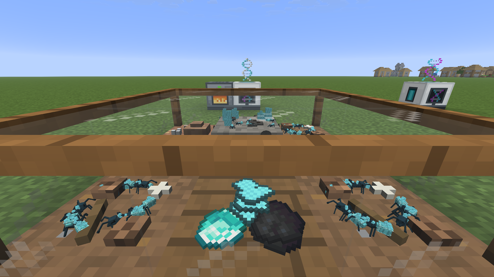 | 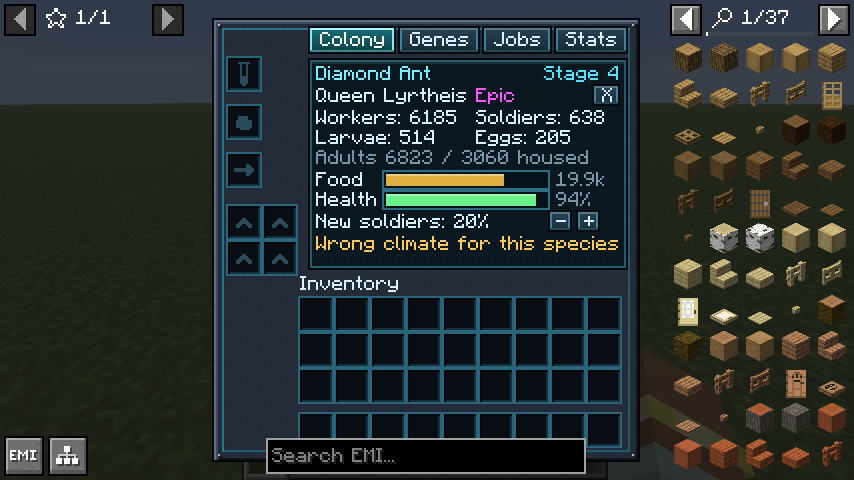 |
| A living Terrarium | The colony screen |
| 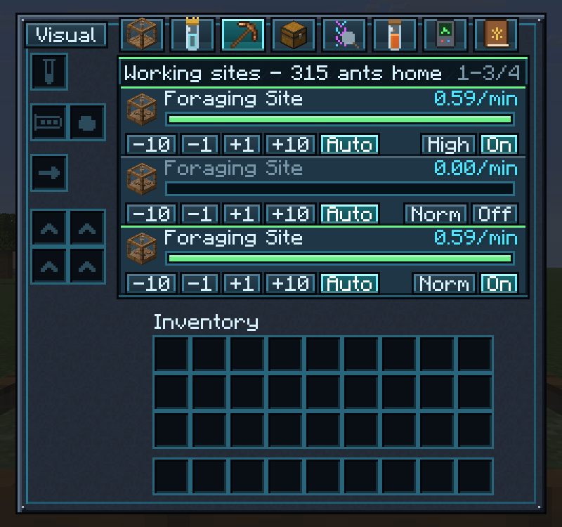 | 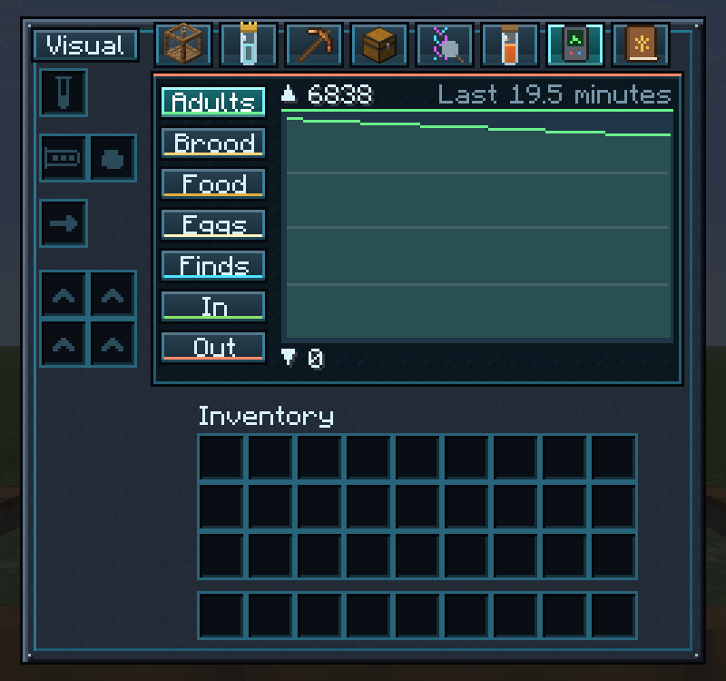 |
| Jobs: ants, priority and modes per site | Statistics: the colony over the last half hour |
| 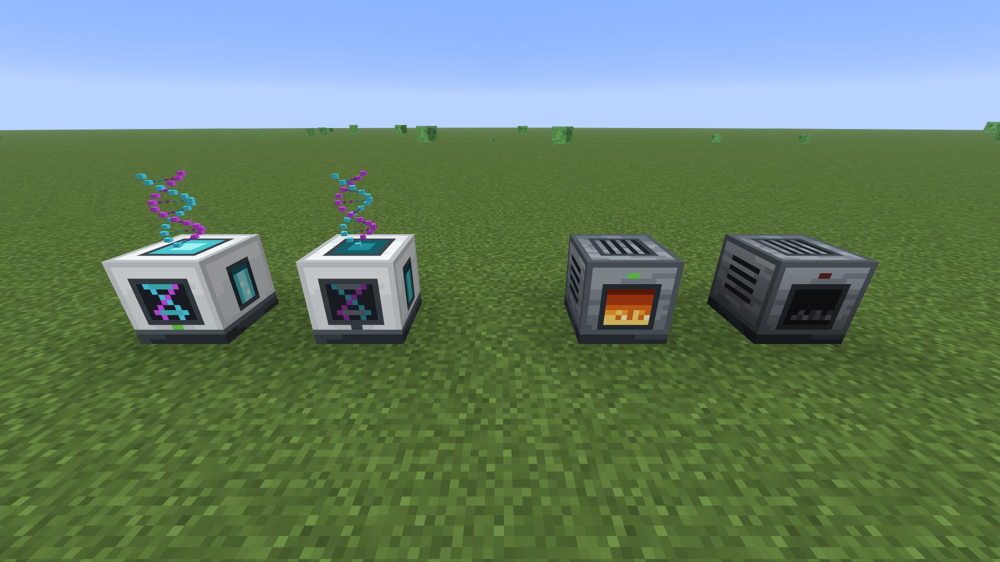 | 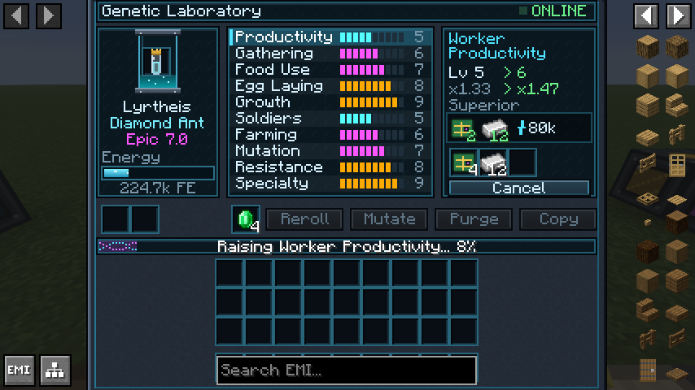 |
| The Genetic Laboratory and the Generator, working and idle | The Genetic Laboratory at work |
| 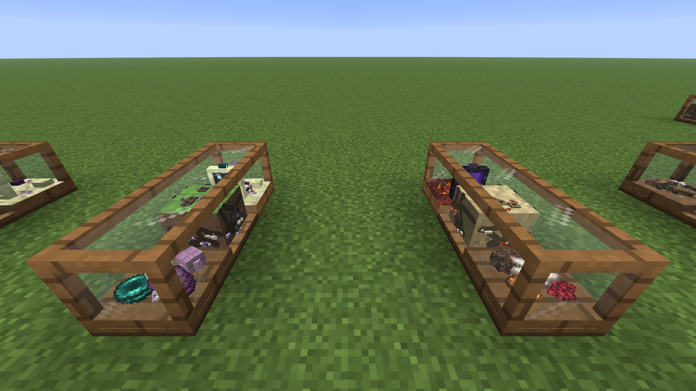 | 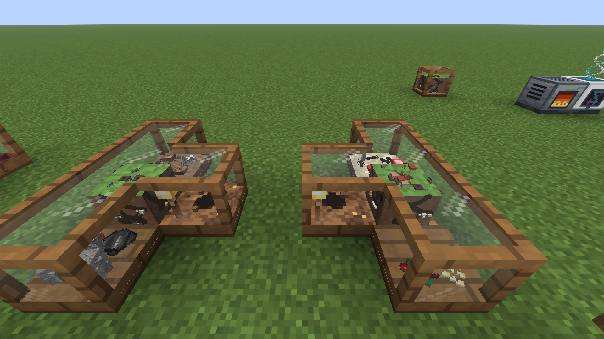 |
| Nether and End Foraging Sites | Colonies linked by Colony Connectors |
| 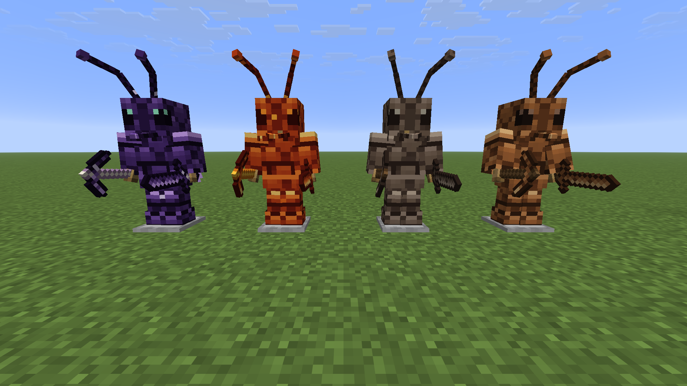 | 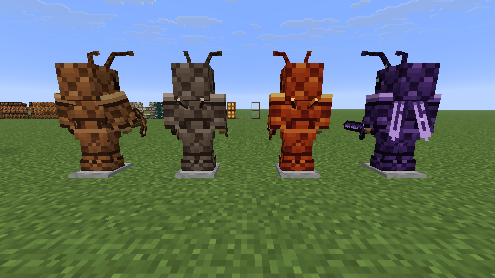 |
| Chitin, Hardened, Infernal and Void armor | Spines and a Queen's wings on the back |
| 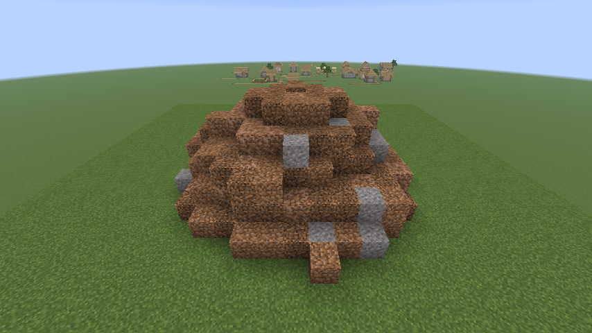 | 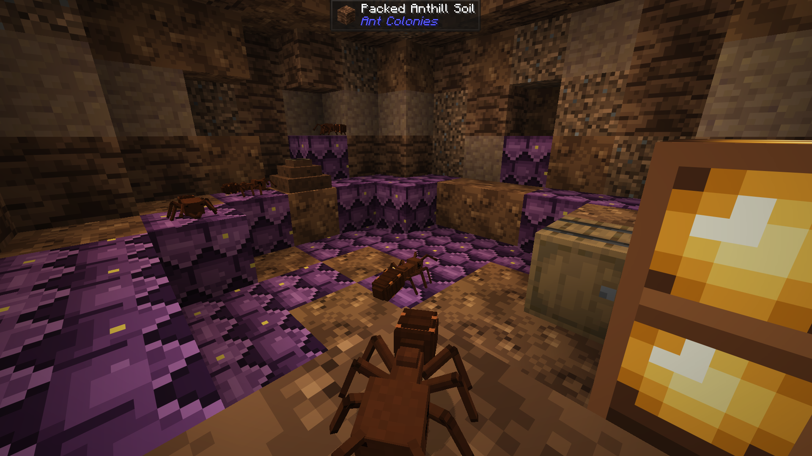 |
| A giant anthill | Inside it |
| 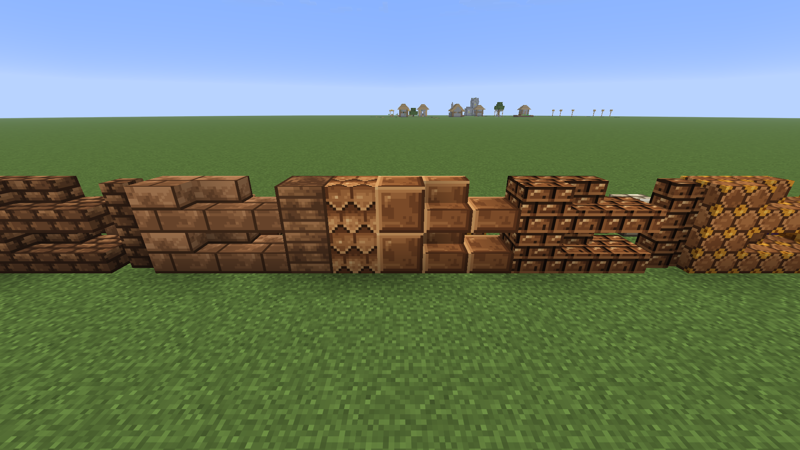 | 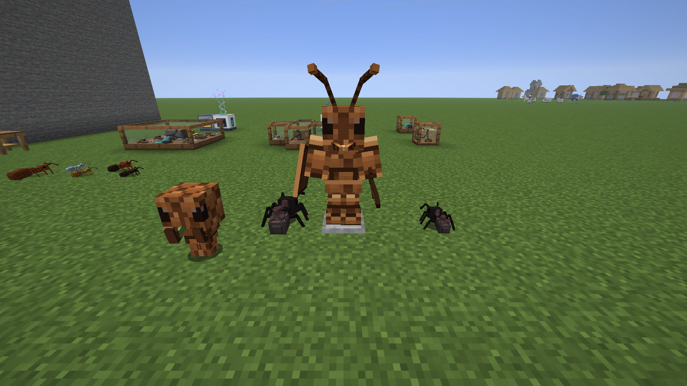 |
| Building blocks: anthill, chitin, amber, fungal and royal | A Guard Ant and Chitin armor |
| 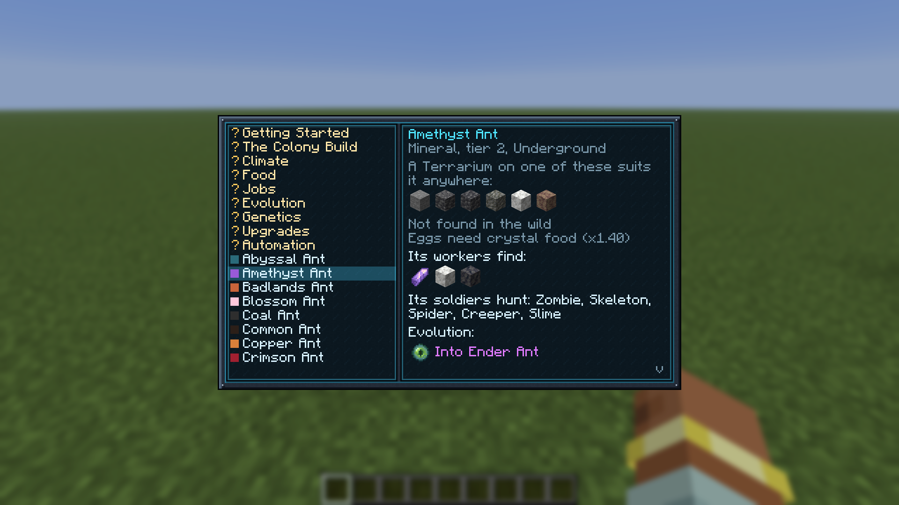 | 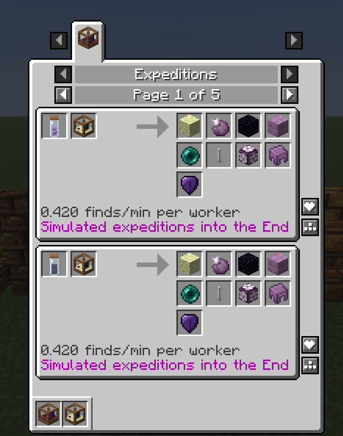 |
| The Ant Identification Book: how to play, and every species | Expeditions and the whole progression in JEI and EMI |
| 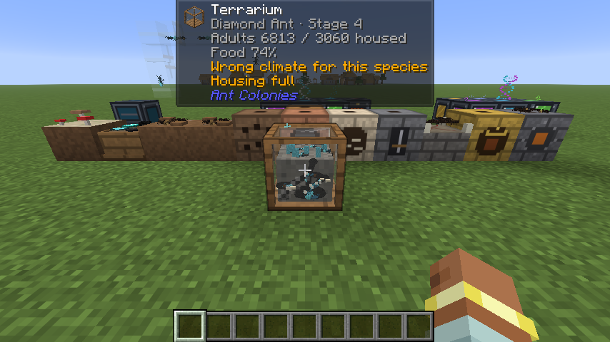 | |
| A Terrarium at a glance with Jade | |

## Versions

Each Minecraft version has its own branch. You are reading the **26.3** branch.

| Minecraft | Branch | Latest release | |
|---|---|---|---|
| 26.3 | [`main`](https://github.com/Kamikadzegga/AntColonies/tree/main) | [0.2.0](https://github.com/Kamikadzegga/AntColonies/releases/tag/v0.2.0) | The main version: new features land here first |
| 26.1.2 | [`26.1.2`](https://github.com/Kamikadzegga/AntColonies/tree/26.1.2) | [0.1.0](https://github.com/Kamikadzegga/AntColonies/releases/tag/v0.1.0-26.1.2) | The same mod for 26.1.2 modpacks, tested with KubeJS; 0.1.0 has the same content as 0.2.0 for 26.3 |

## Installation

1. Install [NeoForge](https://neoforged.net) **26.3.0.101** or newer for Minecraft **26.3** (Java 25).
2. Put `antcolonies-<version>.jar` into your `mods` folder. The mod is needed on both the server and the client.
3. Optional companions:

| Mod | What it adds |
|---|---|
| [JEI](https://www.curseforge.com/minecraft/mc-mods/jei) 31.17+ | 13 recipe categories: species, evolutions, hybrids, production, the laboratory and more |
| [EMI](https://modrinth.com/mod/pf-emi) (the 26.3 port, PF-EMI 1.1) | The same 13 categories in EMI |
| [Jade](https://www.curseforge.com/minecraft/mc-mods/jade) 26.3.5+ | Look at a Terrarium, job site or machine for its state |

To start, craft **Tweezers** and **Test Tubes**, catch a wild Queen, and put her in a **Terrarium** with some ant food.
The [gameplay guide](docs/gameplay.md#getting-started) takes it from there.

## Documentation

| Guide | For |
|---|---|
| [Gameplay guide](docs/gameplay.md) | Players: colonies, structures, species, genetics, anthills, gear and settings |
| [Modpack and KubeJS guide](docs/modpack-guide.md) | Pack makers: every data file and field, recipes, food, spawns, advancements, config |
| [Compatibility](docs/compatibility.md) | Recipe viewers, Jade, and how it works with tech mods' pipes, cables and ores |
| [Changelog](CHANGELOG.md) | What changed in each version |

## Building from source

You need JDK 25. Gradle and the right NeoForge version are downloaded by the wrapper.

```sh
git clone https://github.com/Kamikadzegga/AntColonies.git
cd AntColonies
./gradlew build                # the jar ends up in build/libs/
./gradlew runGameTestServer    # runs the game tests
./gradlew runClient            # starts a development client
```

Data files, textures and branding are generated by the programs in [`tools/`](tools). See
[CONTRIBUTING.md](CONTRIBUTING.md) for how the project is laid out and how changes are tested.

## License

Ant Colonies is released under the [MIT License](LICENSE). Copyright (c) 2026 Kamikadzegga.

Minecraft is a trademark of Mojang Studios. This project is not affiliated with Mojang Studios or Microsoft.
