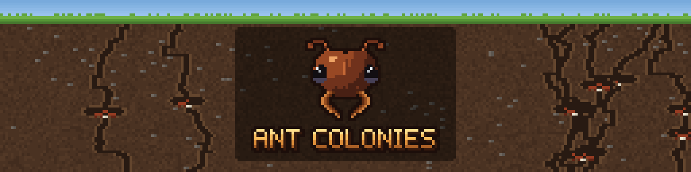
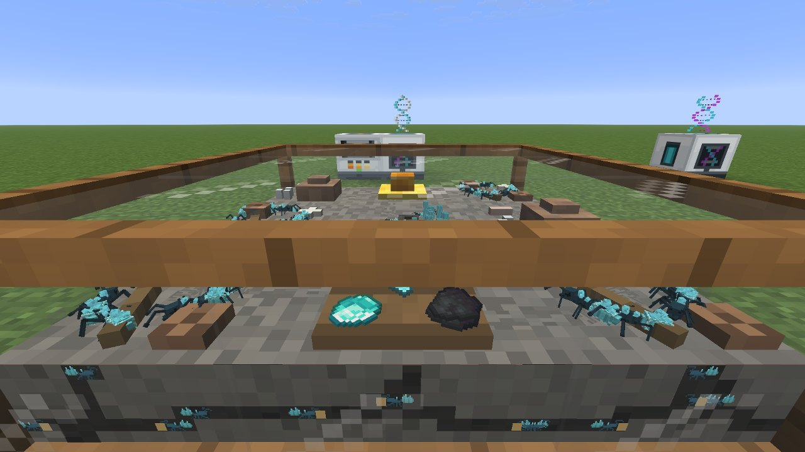
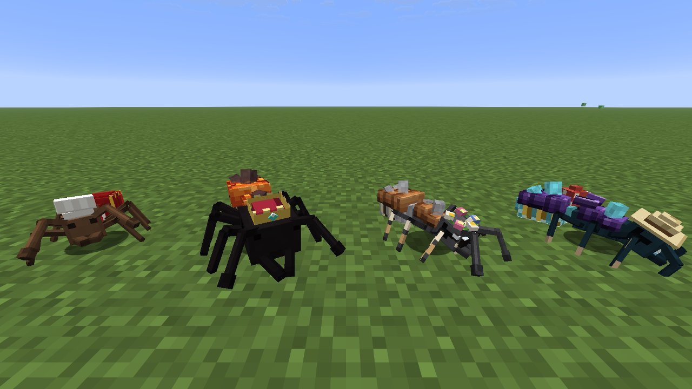
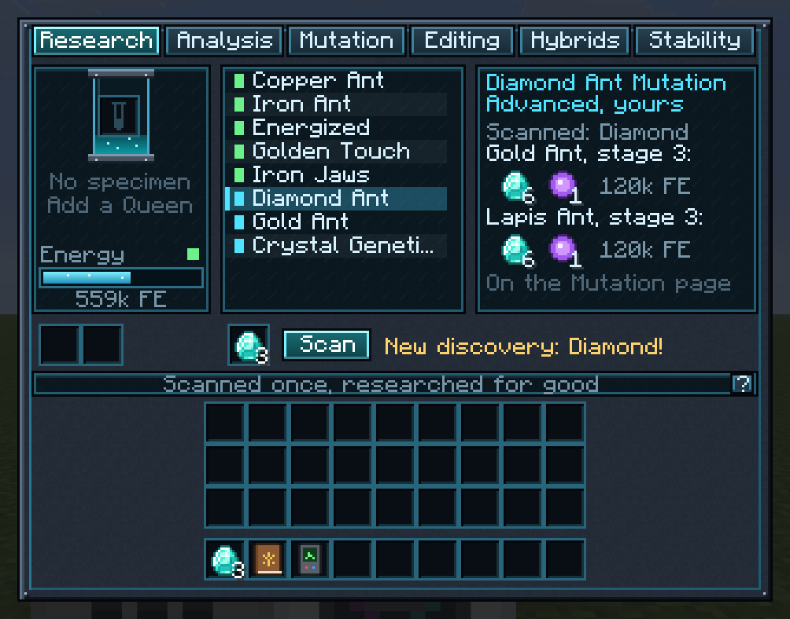
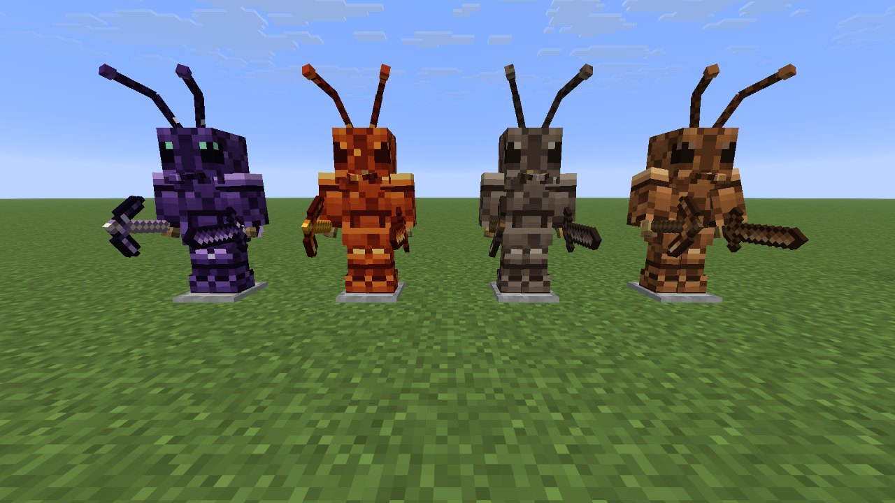

# CurseForge project page

Everything to fill in when creating the Ant Colonies project on CurseForge (Authors Console → Create Project), in the
order the form asks for it. Copy the text between the lines.

## 1. Project settings

| Field | Value |
|---|---|
| Game | Minecraft |
| Class | Mods |
| Project name | `Ant Colonies` |
| Logo | `docs/images/curseforge-logo.png` (400 x 400, as CurseForge requires) |
| Main category | Genetics (under Technology) |
| Additional categories (up to 4) | Farming, Mobs, Structures, Armor, Tools, and Weapons |
| Allow comments | Yes (CurseForge asks for a comment channel, or another way to reach you) |
| Description format | Markdown |
| License | MIT License |

Category names as CurseForge lists them may differ slightly; pick the closest in the dropdown.

**Summary** (shown in search results; CurseForge wants one sentence):

---
Catch wild ants, raise Queens in living Formicariums, and grow colonies that mine, farm, hunt and evolve.
---

**Links** (project settings, after creation):

| Field | Value |
|---|---|
| Source | `https://github.com/Kamikadzegga/AntColonies` |
| Issues | `https://github.com/Kamikadzegga/AntColonies/issues` |
| Wiki | `https://github.com/Kamikadzegga/AntColonies/blob/main/docs/gameplay.md` |

## 2. Description (Markdown)

One text for both Minecraft versions. Images load from the `main` branch.

---

**Build a civilization, one ant at a time.** Catch wild ants, raise a Queen in a living Formicarium and grow her colony
into thousands of workers that mine, farm, hunt and evolve. Then take an ant of your own along as a Guard Ant.

## Colonies

- **Living colonies.** A Formicarium holds a whole colony you can watch: tunnels, eggs, larvae and workers. Place
  chambers against it to grow it: nests, Foraging and Harvesting Sites, Hunting Grounds and Storage.
- **Liquid Ants.** Ants that carry water, lava and other mods' fluids, and a Droplet Centrifuge that turns their
  droplets into the real fluid.
- **Expeditions.** Nether and End ants bring back that dimension's riches through little portals at home.
- **Colony Connectors.** Link nearby colonies so food and items flow to where they are needed.

## Species and genetics

- **59 species.** Catch 17 wild ones, mutate them into iron, diamond, netherite and other mineral ants, breed hybrids,
  and reach the endgame Wither and Dragon Ants. Thirteen are just for fun: a Cow Ant that gives milk, a Baker, a
  Pirate, a Leafcutter under its leaf.
- **Genetic research.** Scan materials in the Genetic Laboratory. Discoveries are permanent, fill in the Ant
  Identification Book and unlock species mutations.
- **Queens with genes.** Every Queen has ten traits and can carry any of 31 mutations, and the game says what each one
  does. She grows with her colony, and the laboratory has a page for every step: Research, Analysis, Mutation,
  Editing, Hybrids and Stability.
- **Hybrids.** Copy a Queen's genes into a Genetic Sample and raise her daughters in another species' Queen Chamber.
  Better Queens make a hybrid more likely, and the chamber shows the chance.

## Guard Ants

- **Any ant can join you.** A Rally Pheromone wins over a wild ant of any species, and any colony gives one. It stays
  the ant it was: an Iron Ant becomes an Iron Guard Ant.
- **It fights and learns.** Tell it to follow, stay or guard. It learns from its own kills up to level 50, mends when
  it rests, and comes with you through portals and teleports.
- **Dress it.** Ant Plates in four tiers of chitin, eight hats and packs for looks, and an Ant Cart with nine slots.
- **Keep track.** A list shows where each of your Guard Ants is and calls one to you from anywhere.
- **It is yours to lose.** A Guard Ant that dies is gone, and leaves what it wore and carried.

## The world

- **Anthills.** Explore giant anthills in the Overworld, the Nether and the End, each built and furnished to suit its
  biome, with loot, soldiers and a great Queen guarded by her Royal Guard Ants. Touch their chests and the whole
  anthill comes after you.
- **Chitin gear.** Four tiers of ant armor and tools, with jaws, spines and wings. In a full set, wild ants leave you
  alone.
- **Building blocks.** Anthill bricks, chitin plates, amber, fungal and royal blocks, with stairs, slabs and walls.

## Made to be played with

- **Easy to follow.** A colony screen with pictures or exact numbers and charts, tooltips that say what goes where,
  JEI, EMI and Jade support, and an in-game guide book.
- **Light on servers.** Colonies are numbers, not mobs: 100 big colonies used under 5% of a server tick in testing,
  and a Guard Ant costs about what a tamed wolf does.
- **Made for modpacks.** Species, evolutions, mutations, food and loot are data packs, a server config sets the
  numbers, and there are ants for the ores and fluids of the big packs.

## Getting started

1. Craft **Tweezers** and **Test Tubes**.
2. Use the Tweezers on a wild ant nest: your first catch from each kind of nest is a Queen.
3. Place a **Formicarium** and put the Queen and some Ant Food in it.
4. Add chambers as the colony grows. JEI or EMI shows every recipe.
5. Build a **Genetic Laboratory**, scan materials in it and mutate your Queens into mineral ants.
6. Craft a **Rally Pheromone** and use it on a wild ant: your first Guard Ant.

## Requirements

Minecraft **26.3** with NeoForge **26.3.0.101** or newer, or Minecraft **26.1.2** with NeoForge **26.1.2.122** or newer.
Java 25. Install it on both the client and the server.
Optional: JEI, EMI, Jade, FTB Teams, MachinaOpus.

## Links

- [Source code and full documentation](https://github.com/Kamikadzegga/AntColonies)
- [Gameplay guide](https://github.com/Kamikadzegga/AntColonies/blob/main/docs/gameplay.md)
- [Bug reports and ideas](https://github.com/Kamikadzegga/AntColonies/issues)

Free to use in any modpack (MIT License).
---

## 3. Images (Media tab)

Upload these 34 from `docs/images/screenshots/`, in this order:

| File | Title | Description |
|---|---|---|
| `overview.jpg` | A colony at work | A Formicarium and its chambers, joined into one glass build |
| `terrarium.jpg` | A living Formicarium | Workers dig tunnels and carry food behind the glass |
| `vertical-formicarium.jpg` | Built upward | Stacked blocks become one nest behind glass, chambers joined by tunnels |
| `liquid-ants.jpg` | Liquid Ants | Ants that carry fluids, and the Droplet Centrifuge |
| `ants-for-fun.jpg` | Ants for fun | Ten species in costumes: a Cow Ant, a Baker, a Pirate and more |
| `hunting-ground.jpg` | Hunters | Bullet Ants fighting at their Hunting Ground |
| `guard-ants.jpg` | Guard Ants | Ants of four species in plates, hats and marks |
| `colony-screen.png` | The colony screen | Queen, health, food and ants at a glance |
| `jobs-screen.png` | Jobs | Ants, priority and modes for every working site |
| `statistics-screen.png` | Statistics | The colony over the last half hour |
| `genetics-screen.png` | Genetics | The Queen's traits and what her mutations do |
| `laboratory-research.png` | Genetic research | Scan a material in the Genetic Laboratory and keep the discovery |
| `laboratory-analysis.png` | Analysis | A Queen's genes and what she can become |
| `laboratory-mutation.png` | Species Mutation | A Stone Ant Queen becomes an Iron Ant |
| `genetic-laboratory.png` | Editing | Raise, reroll, mutate, purge and copy a Queen's genes |
| `laboratory-hybrids.png` | Hybrids | Copy a Queen's genes for a cross |
| `queen-chamber.png` | The Queen Chamber | Four Genetic Samples, and the hybrid's chance |
| `identification-book.png` | The Ant Identification Book | How to play, and every species |
| `book-research.png` | Research in the book | What you have discovered and what is still unknown |
| `chitin-tiers.jpg` | Chitin armor | Chitin, Hardened, Infernal and Void |
| `chitin-tiers-back.jpg` | Spines and wings | The higher tiers from behind |
| `expedition-sites.jpg` | Expeditions | Nether and End Foraging Sites |
| `connected-colonies.jpg` | Colony Connectors | Food and items between nearby colonies |
| `building-blocks.jpg` | Building blocks | Anthill, chitin, royal, amber and fungal blocks, and anthill soil in four of its tones |
| `giant-anthill.jpg` | A giant anthill | A structure with loot and defenders |
| `anthills-overworld.jpg` | Anthills by biome | Desert, badlands, taiga and ice spikes |
| `anthills-nether-end.jpg` | Nether and End anthills | Crimson and warped forests, a soul sand valley and the End's highlands |
| `anthill-queen-chamber.jpg` | Inside an anthill | The great Queen's chamber, and a Queen to catch |
| `anthill-rooms.jpg` | Furnished rooms | A fungus garden, an aphid farm, a nursery and a treasure chamber |
| `wild-nest.jpg` | A wild nest | One worker walks around every nest |
| `machines.jpg` | The machines | The Generator and the Droplet Centrifuge, working and idle |
| `recipe-viewer.png` | JEI and EMI | Expeditions and every recipe |
| `recipe-viewer-mutation.png` | Species Mutation recipes | Every species mutation and what it needs |
| `jade.jpg` | Jade | A Formicarium's state without opening it |

## 4. Files (upload a file)

| Field | Value |
|---|---|
| File | `build/libs/antcolonies-26.1.2.0.7.0.jar` |
| Display name | `Ant Colonies 0.7.0` |
| Release type | Beta (or Release once it has been played for a while) |
| Game version | 26.1.2 |
| Mod loader | NeoForge |
| Java | Java 25 |
| Environment | Client and Server |
| Related projects | Optional: JEI, EMI, Jade, FTB Teams, MachinaOpus |
| Changelog | The `[0.7.0]` section of `CHANGELOG.md` |

The version is 0.7.0 (`mod_version` in `gradle.properties`). `CHANGELOG.md` lists what 0.7.0 changed.
