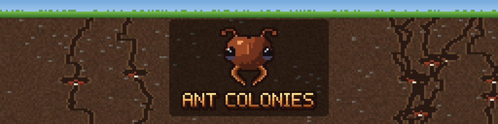

# CurseForge project page

Everything to fill in when creating the Ant Colonies project on CurseForge (Authors Console → Create Project), in the
order the form asks for it. Copy the text between the lines.

## 1. Project settings

| Field | Value |
|---|---|
| Game | Minecraft |
| Class | Mods |
| Project name | `Ant Colonies` |
| Logo | `docs/images/curseforge-logo.png` (400 x 400, as CurseForge requires) |
| Main category | Genetics (under Technology) |
| Additional categories (up to 4) | Farming, Mobs, Structures, Armor, Tools, and Weapons |
| Allow comments | Yes (CurseForge asks for a comment channel, or another way to reach you) |
| Description format | Markdown |
| License | MIT License |

Category names as CurseForge lists them may differ slightly; pick the closest in the dropdown.

**Summary** (shown in search results; CurseForge wants one sentence):

---
Catch wild ants, raise Queens in living Terrariums, and grow colonies that mine, farm, hunt and evolve.
---

**Links** (project settings, after creation):

| Field | Value |
|---|---|
| Source | `https://github.com/Kamikadzegga/AntColonies` |
| Issues | `https://github.com/Kamikadzegga/AntColonies/issues` |
| Wiki | `https://github.com/Kamikadzegga/AntColonies/blob/main/docs/gameplay.md` |

## 2. Description (Markdown)

---

# Build a civilization, one ant at a time

Catch wild ants with Tweezers, settle a Queen in a **Terrarium**, and watch her colony grow: eggs, larvae and
thousands of workers digging tunnels behind the glass. Put them to work foraging, farming and hunting, evolve them into
iron, diamond and netherite ants, breed hybrids, and engineer the perfect Queen in the Genetic Laboratory.

Colonies are simulated as numbers on the server, so even a colony of thousands costs almost nothing; the ants you see
are pictures of it.

## Living colonies

- **A Terrarium is a whole colony**: a Queen, eggs, larvae, workers, food and health. It works on its own.
- **Chambers grow it**: place them against the Terrarium and they join into one glass build. Nest Chambers house more
  ants, **Foraging Sites** send workers out for resources, **Harvesting Sites** let farmer species grow food, **Hunting
  Grounds** let hunter species kill mobs for their drops (no mob is ever spawned), and Storage and Queen Chambers keep
  the finds and raise new Queens.
- **Climate matters**: each species likes temperate, cold, hot, underground or nether conditions. A block under the
  Terrarium sets its climate.
- **Colony stages** from a handful of ants to a metropolis: bigger colonies find rarer things.

## 46 species

- **16 wild species**, each in its own biomes with nests to raid: Common, Wood, Stone, Snow, Desert, Farmer, Jungle,
  Swamp, Savanna, Shore, Blossom, Pale, Badlands, the hunting Army Ant, the Nether's **Warped Ant** and the End's
  **Chorus Ant**.
- **Evolve** them by feeding the Queen: iron, copper, coal, gold, redstone, lapis, amethyst, diamond, emerald,
  netherite, fire, soul, ender and more.
- **11 hybrids** from crossing Queens in a Queen Chamber: Crystal Wood, Mechanical Miner, Honeypot, Reef, Sculk,
  Excavator and others.
- **Endgame**: the **Wither Ant** (Soul Ants fed a Nether Star) and the **Dragon Ant** (Ender Ants fed the dragon's
  breath).
- **13 more** turn on with other mods' ores: tin, lead, silver, uranium, osmium, zinc and more (MachinaOpus, Mekanism,
  Create, Thermal, Immersive Engineering, AE2).

## Progression through the dimensions

- The Nether's ants evolve only in a Terrarium **in the Nether**, the End's only **in the End**. Bring your colony
  there in Test Tubes, evolve it, and bring it home.
- The **Chitin ladder**: Hardened Chitin (Blast Furnace), Infernal Chitin (the Nether) and Void Chitin (the End) gate
  the upgrades and the highest genetics.
- **Tier IV upgrades**, the endgame: Void Chitin and netherite.
- **27 advancements**, with a path through the Nether and the End.

## Genetics

Every Queen has **ten traits** (productivity, egg laying, food use, resistance and more), and her daughters inherit
them with variation. There are **31 mutations**, good and bad. The FE-powered **Genetic Laboratory** raises traits,
rerolls them, adds and purges mutations, and copies a Queen's genes.

## The world

- **Giant anthills**: rare mounds over tunnels dug deep into the ground, with loot, soldiers that defend them and a
  Queen to catch.
- **Nether anthills**: the same nest dug into the Nether's floor, in soul soil and blackstone, home to Fire Ants.
- **Home nests**: pick up a wild nest with Silk Touch and place it at home. Its ants tend and harvest your crops within
  10 blocks, replant them and carry the harvest inside, for hoppers and pipes to take out.

## Gear and companions

- **Chitin tools, armor and shield**: iron-tier gear of overlapping scales. The helmet is an ant's head with antennae,
  and in the full set wild ants take you for one of their own.
- **Guard Ants**: a hunter colony gives up some of its ants for a tamed Guard Ant that follows you and fights for you,
  as strong as the colony's genetics.

## Made for automation and modpacks

- Comparator outputs, and redstone to pause job sites and machines.
- Items and FE move through any mod's pipes and cables (tested with MachinaOpus).
- Species, evolutions, hybrids, mutations, lab costs, ant food and loot are all **data packs**; a server config sets
  every number. A full modpack and KubeJS guide is in the source repository.

## Explained in game

The Terrarium's Info page shows what its ants find and hunt, the climate they need and what they evolve into. The
**Ant Identification Book** has how-to-play pages and every species.

## Getting started

1. Craft **Tweezers** and **Test Tubes**.
2. Find a wild nest and use the Tweezers on it (an empty Test Tube in your inventory) until you catch a Queen.
3. Craft a **Terrarium**, put the Queen and some Ant Food in it, and watch the colony start.
4. Add chambers against it as it grows. JEI or EMI shows every recipe and evolution.

## Requirements

- Minecraft **26.3**, NeoForge **26.3.0.101** or newer, Java 25.
- Needed on both the server and the client. Works in single player and on servers.

## Optional companions

| Mod | Adds |
|---|---|
| JEI | 13 recipe categories: species, evolutions, hybrids, production, the laboratory and more |
| EMI | The same 13 categories |
| Jade | Look at a Terrarium, job site, nest or machine for its state |
| MachinaOpus | Its metals from ants (tin, lead, silver, uranium, fluorite), and Molybdenum, Sulfur and Rubber Ants |

## Links

- Source code and full documentation: [GitHub](https://github.com/Kamikadzegga/AntColonies)
- Bug reports and ideas: [Issues](https://github.com/Kamikadzegga/AntColonies/issues)
- [Gameplay guide](https://github.com/Kamikadzegga/AntColonies/blob/main/docs/gameplay.md) ·
  [Modpack guide](https://github.com/Kamikadzegga/AntColonies/blob/main/docs/modpack-guide.md)

You may use Ant Colonies in any modpack. It is released under the MIT License.
---

## 3. Images (Images tab, with the carousel turned on)

Upload these from `docs/images/screenshots/`, in this order:

| File | Title | Description |
|---|---|---|
| `overview.png` | A stage 4 colony | A Terrarium and its chambers, joined into one glass build |
| `terrarium.png` | A living Terrarium | Workers dig tunnels and carry food behind the glass |
| `colony-screen.png` | The colony screen | Population, food, health and jobs at a glance |
| `genetic-laboratory.png` | The Genetic Laboratory | Raise, reroll and mutate a Queen's traits |
| `giant-anthill.png` | A giant anthill | A rare world structure with loot and defenders |
| `anthill-queen-chamber.png` | The Queen's chamber | Deep under the anthill, a Queen to catch |
| `guard-ant-and-chitin.png` | Chitin armor and a Guard Ant | Ant-head helmet with antennae, scale armor, shield |
| `recipe-viewer.png` | JEI and EMI | Every species, evolution and recipe |
| `identification-book.png` | The Ant Identification Book | How to play, and every species |
| `jade.png` | Jade tooltips | A Terrarium's state without opening it |

## 4. Files (upload a file)

| Field | Value |
|---|---|
| File | `build/libs/antcolonies-26.3.0.0.1.jar` |
| Display name | `Ant Colonies 0.0.1` |
| Release type | Beta (or Release once it has been played for a while) |
| Game version | 26.3 |
| Mod loader | NeoForge |
| Java | Java 25 |
| Environment | Client and Server |
| Related projects | Optional: JEI, EMI, Jade, MachinaOpus (if published) |
| Changelog | The `[0.0.1]` section of `CHANGELOG.md` |

The version is 0.0.1 (`mod_version` in `gradle.properties`), and `CHANGELOG.md` has a single 0.0.1 entry listing
everything the mod has. If you also want a GitHub release, tag the commit `v0.0.1` (the changelog links to that tag).
