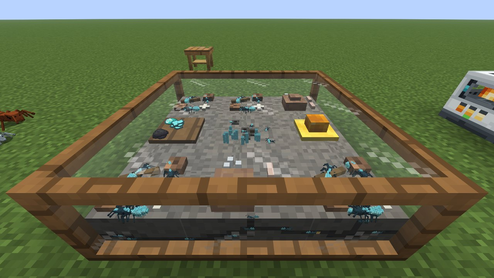
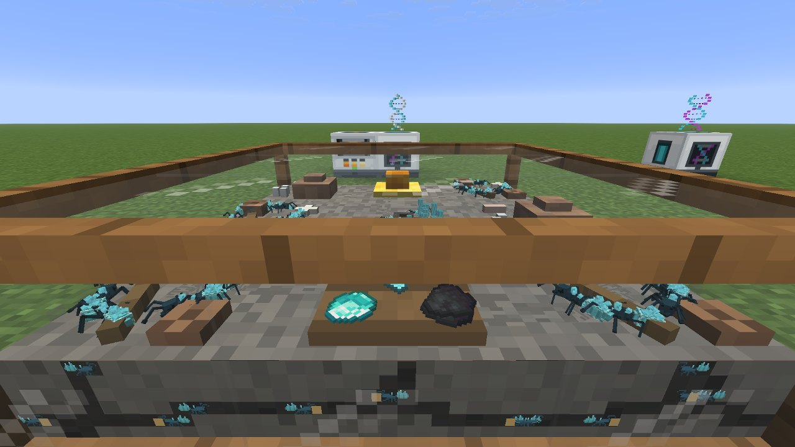
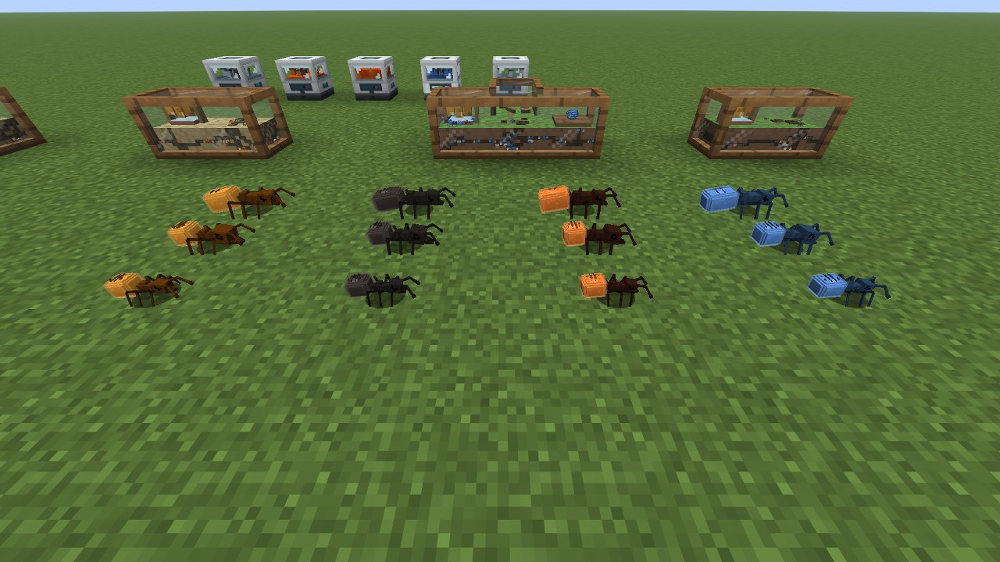
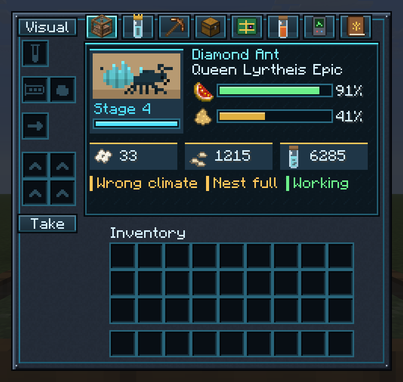
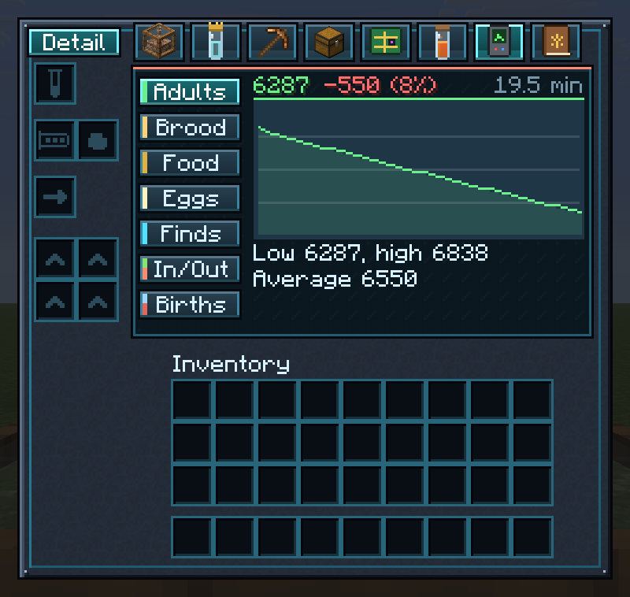
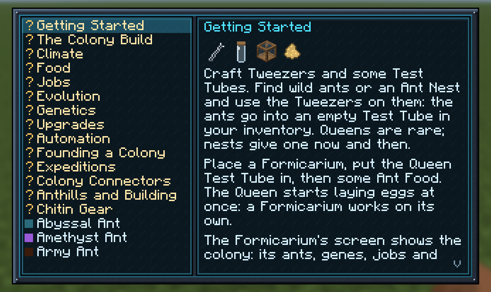
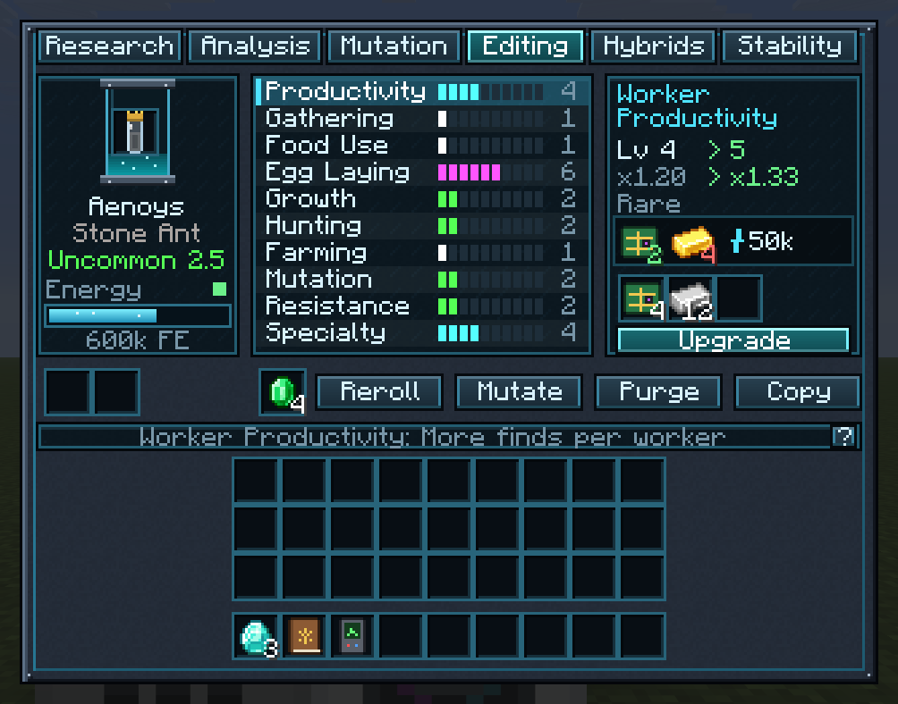
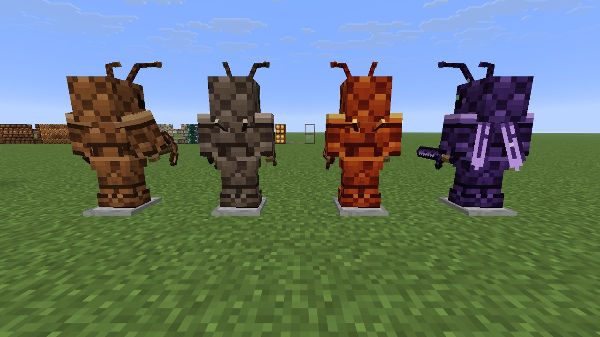

# Gallery

Screenshots of Ant Colonies. The [gameplay guide](gameplay.md) explains what they show.

## Colonies

| | |
|:---:|:---:|
|  |  |
| A Formicarium and its chambers, joined into one build | A living Formicarium |
|  |  |
| A colony built upward: one nest behind glass, its chambers joined by tunnels | Liquid Ants, each carrying its fluid, and the Droplet Centrifuge |
|  |  |
| Nether and End Foraging Sites | Colonies linked by Colony Connectors |

## Screens

| | |
|:---:|:---:|
|  |  |
| The colony screen | Jobs: ants, priority and modes per site |
|  |  |
| Statistics: the colony over the last half hour | The Ant Identification Book: how to play, and every species |

## Machines

| | |
|:---:|:---:|
|  |  |
| The Generator and the Droplet Centrifuge, working and idle | The Genetic Laboratory at work |

## The world

| | |
|:---:|:---:|
|  |  |
| A giant anthill | Inside it |
|  |  |
| Chitin, Hardened, Infernal and Void armor | Spines and a Queen's wings on the back |
|  | |
| Building blocks: anthill, chitin, amber, fungal and royal | |

## Other mods

| | |
|:---:|:---:|
|  |  |
| Expeditions and the whole progression in JEI and EMI | A Formicarium at a glance with Jade |
